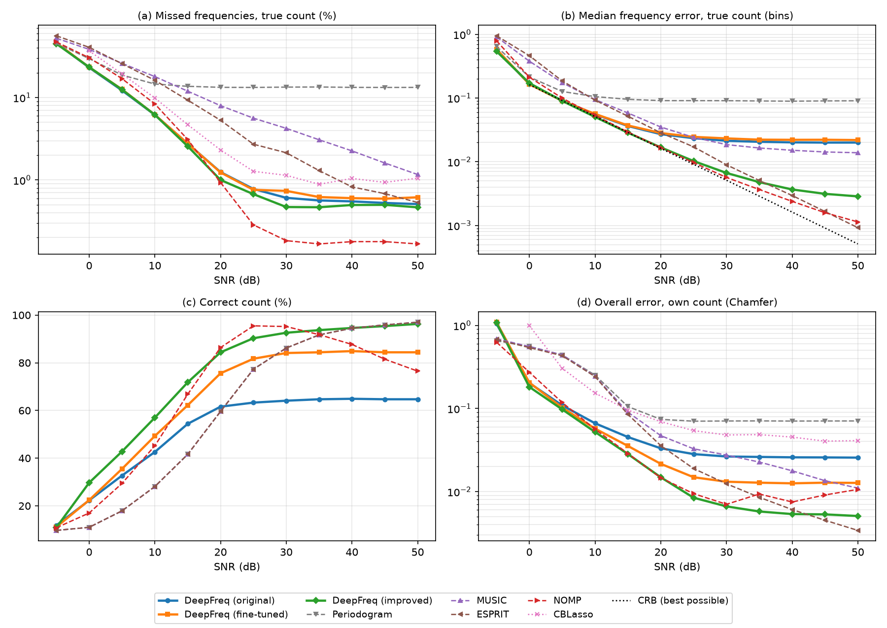
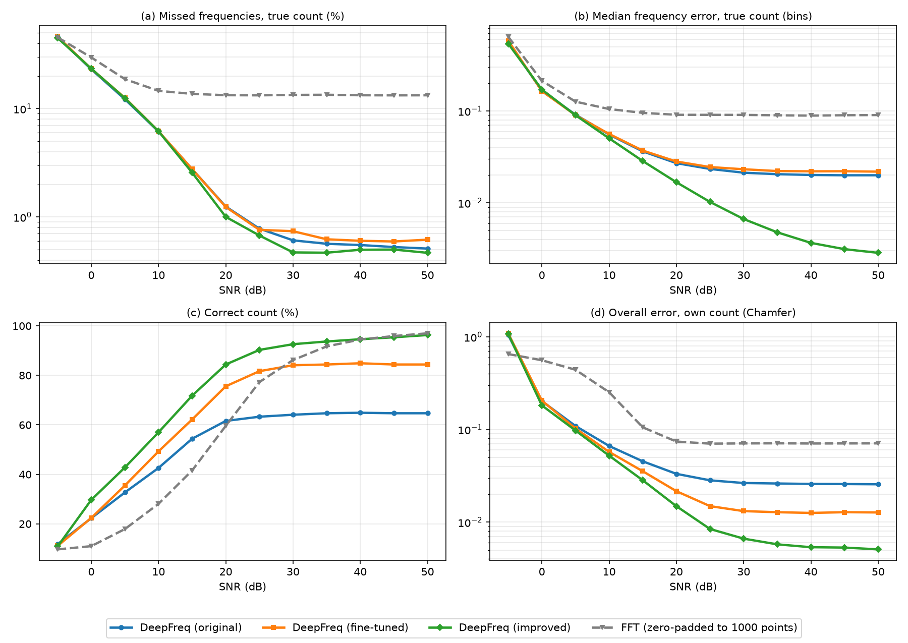

# 6. Final comparison: DeepFreq versions vs classical methods

One script, `compare_all.py`, runs every method on the same test signals and
draws the figures in `results/figures/`. Numbers are in `results/comparison.csv`.

```bash
python experiments/6_final_comparison/compare_all.py        # about 5 minutes on the iMac CPU
python experiments/6_final_comparison/compare_all.py plot   # redraw figures only
```

## Which data, and why

The saved **test sets** in the repository root:

- `test_dataset/`: 1000 signals at each SNR from 0 to 50 dB (steps of 5 dB),
- `test_dataset_low_snr/`: the −5 dB set (only this file is used from that folder).

Each signal has 50 samples and 1 to 10 frequencies. These sets were made once
with a fixed random seed and **never used for training**, so they are a fair
exam for every method, and the numbers are reproducible. They are also the
sets the 2019 DeepFreq paper used, so the CBLasso numbers saved by its authors
(`test_dataset/cblasso_results/`) can be put on the same plots.

## Methods

| Line | What it is |
|---|---|
| DeepFreq (original) | 2019 pretrained FR model + FC model (`pretrained_models/DeepFreq`) |
| DeepFreq (fine-tuned) | your fine-tuned FR + FC models (`checkpoint/finetune_experiment`, epoch 310) |
| DeepFreq (improved) | the best system from `4_combined/`: FR model trained further, new counter instead of the FC model's count, and the clean-up step |
| Periodogram | FFT spectrum, pick the highest peaks |
| MUSIC, ESPRIT | classical subspace methods |
| NOMP | greedy fit-and-subtract method (2016); it is told the true noise level to decide when to stop |
| CBLasso | the DeepFreq authors' saved results (0–50 dB only, no timing) |
| CRB | Cramér–Rao bound: the smallest error any unbiased method can reach |

Periodogram, MUSIC and ESPRIT count the frequencies with MDL, so they share the
same count accuracy.

## Measures

- **(a) Missed frequencies, true count (FNR, %)**: each method is told how many
  frequencies there are; how many true ones did it miss? Lower is better.
- **(b) Median frequency error, true count (bins)**: how close the found
  frequencies are, in units of 1/50. Lower is better; the CRB is the floor.
- **(c) Correct count (%)**: how often the method's own count is exactly right.
- **(d) Overall error, own count (Chamfer)**: the DeepFreq paper's overall
  measure for the full system (count + locations). Lower is better.
- **(e) Speed**: CPU time per signal, batch of 1000, 4 threads.

## Results



Selected numbers (−5 / 0 / 10 / 20 / 30 / 50 dB):

| Method | Missed, true count (%) | Correct count (%) | Overall error (Chamfer) |
|---|---|---|---|
| DeepFreq (original) | 45.8 / 23.1 / 6.16 / 1.25 / 0.61 / 0.51 | 11.8 / 22.3 / 42.6 / 61.6 / 64.1 / 64.7 | 1.05 / 0.203 / 0.066 / 0.033 / 0.026 / 0.026 |
| DeepFreq (fine-tuned) | 46.1 / 23.3 / 6.19 / 1.24 / 0.74 / 0.62 | 11.1 / 22.4 / 49.3 / 75.6 / 84.1 / 84.4 | 1.09 / 0.205 / 0.057 / 0.022 / 0.013 / 0.013 |
| DeepFreq (improved) | 45.0 / 23.4 / 6.18 / 1.00 / 0.47 / 0.47 | 10.9 / 29.7 / 57.0 / 84.4 / 92.6 / 96.3 | 1.08 / 0.182 / 0.052 / 0.015 / 0.0066 / 0.0051 |
| Periodogram | 45.5 / 29.7 / 14.6 / 13.3 / 13.4 / 13.3 | 9.7 / 11.0 / 28.1 / 59.6 / 86.2 / 97.0 | 0.65 / 0.559 / 0.253 / 0.074 / 0.071 / 0.071 |
| MUSIC | 52.4 / 38.4 / 18.0 / 7.97 / 4.23 / 1.17 | same as periodogram | 0.69 / 0.557 / 0.245 / 0.047 / 0.028 / 0.011 |
| ESPRIT | 56.2 / 40.7 / 16.2 / 5.30 / 2.14 / 0.53 | same as periodogram | 0.68 / 0.541 / 0.242 / 0.036 / 0.012 / 0.0034 |
| NOMP | 47.3 / 30.4 / 8.37 / 0.93 / 0.18 / 0.17 | 10.8 / 17.0 / 45.2 / 86.4 / 95.2 / 76.5 | 0.63 / 0.274 / 0.056 / 0.015 / 0.0070 / 0.011 |
| CBLasso | – / 36.8 / 9.89 / 2.31 / 1.14 / 1.05 | – | – / 0.995 / 0.153 / 0.069 / 0.048 / 0.041 |

CPU time per signal: periodogram 0.13 ms, ESPRIT 0.24 ms, MUSIC 0.6 ms,
DeepFreq about 5 ms (original and fine-tuned) and 5.6 ms (improved), NOMP
0.8–7 ms (slower when it finds more frequencies). See `fig_e_speed.png`.

## What it shows

- **Low and medium noise (0–15 dB): all three DeepFreq versions are the best
  at finding frequencies.** They miss far fewer than periodogram, MUSIC, ESPRIT
  and CBLasso, and slightly fewer than NOMP.
- **Fine-tuning mainly improved counting** (75.6 % vs 61.6 % correct at 20 dB),
  which roughly halves the overall error at 20 dB and above. Finding
  frequencies when the count is known is about the same as the original.
- **The improved version is the best DeepFreq at every SNR from 0 dB up**: it
  counts best (84 % at 20 dB, 96 % at 50 dB) and, thanks to the clean-up step,
  its frequencies are about 7× more exact than the original's at 50 dB. Its
  overall error is the lowest of all methods from 0 to 40 dB (tied with NOMP at
  15–20 dB); only ESPRIT is lower at 45–50 dB.
- **At very little noise (30 dB and above), the classical fitting methods catch
  up.** NOMP misses fewer frequencies and ESPRIT/NOMP get closer to the CRB.
  NOMP also needs the true noise level, which DeepFreq does not.
- **At −5 dB nothing works well**; all methods miss about half the frequencies.
  DeepFreq's overall error there is higher than the classical methods'.
- **Speed:** on this CPU the DeepFreq pipelines take about 5 ms per signal, so
  they are not faster than the simple classical methods. Most of that time is
  the peak-picking step in Python; the networks themselves take about 1 ms
  (see `extra_speed_test/`).

## DeepFreq vs the FFT only



The "Periodogram" method above *is* the FFT: the signal is zero-padded to 1000
points (the same grid the FR model uses), the squared FFT magnitude is taken,
and the highest peaks are picked. `fig_fft_vs_deepfreq.png` shows only that
line against the three DeepFreq versions.

- The FFT misses about 13 % of frequencies even with almost no noise. With only
  50 samples its peaks are about 1 bin wide, so two frequencies close together
  merge into one peak, and the side lobes of a strong frequency can hide a weak one.
- Its error stops falling at about 0.09 bins for the same reason: nearby
  frequencies pull each other's peaks off position.
- All DeepFreq versions miss far fewer (about 1 % at 20 dB) because the FR model
  learned to draw sharp peaks even for close frequencies.
- The FFT itself has no way to count; here it uses MDL, which is worse than the
  DeepFreq counters below 25 dB and similar above.
